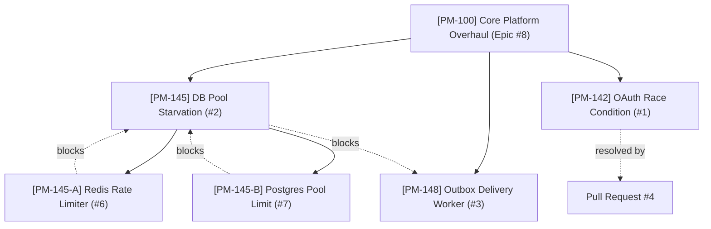

# 📁 beyondCode-in PM Tool — Directory & Folder Hierarchy

> This directory tree mirrors the folderization in Jira and ClickUp Spaces. Each folder contains the scoped tickets, subtasks, and dependency references.

```text
directory/
├── 01-core-infrastructure/
│   ├── README.md
│   ├── epics/
│   │   └── PM-100-core-platform-overhaul.md  (ROOT EPIC #8)
│   ├── sprint-12/
│   │   ├── PM-142-oauth-token-race-condition.md  (BUG #1)
│   │   ├── PM-145-database-pool-starvation/      (INCIDENT #2)
│   │   │   ├── README.md
│   │   │   ├── PM-145-A-redis-rate-limiter.md    (SUBTASK #6)
│   │   │   └── PM-145-B-postgres-pool-limit.md   (SUBTASK #7)
│   └── backlog/
│       └── PM-148-outbox-delivery-worker.md      (FEATURE #3)
└── 02-customer-requests/
    ├── README.md
    └── PM-152-csv-export-button.md               (REQUEST #5)
```

---

## 🔗 Root-to-Leaf Dependency Graph


