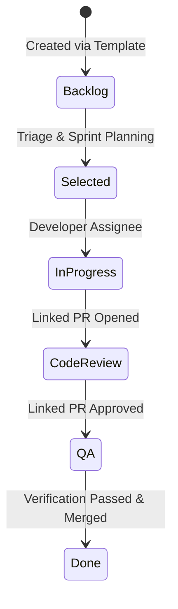

# Jira & ClickUp 3.0 Architectural Feature Mapping

> **Comprehensive feature alignment matrix combining Jira Enterprise and ClickUp 3.0 capabilities into GitHub Projects V2 & Template Engine (`beyondCode-in/pm-tool`).**

---

## 🏛️ 1. Structural Hierarchy Comparison

| Hierarchy Layer | Jira Software | ClickUp 3.0 | `pm-tool` (GitHub Engine) |
| --- | --- | --- | --- |
| **Top Container** | Organization / Project | Workspace | GitHub Organization (`beyondCode-in`) |
| **Domain Grouping** | Project Category / Board | Space | GitHub Project V2 Board (`pm-tool` #34) |
| **Category Container** | Component / Release Version | Folder | Project Custom Field (`Component`) + Milestone |
| **Work Unit Group** | Epic / Theme | List / Task Group | Epic Issue Type + Project Grouping Views |
| **Primary Work Unit** | Story / Task / Bug | Task | GitHub Issue (#1 - #100) |
| **Sub-Unit** | Sub-task | Subtask | Parent-Child Linked Sub-Issues + Markdown Checklists |

---

## 🎨 2. Custom Fields & Dynamic Views Matrix

| Feature | Jira Software | ClickUp 3.0 | `pm-tool` Implementation |
| --- | --- | --- | --- |
| **Kanban Board** | Board (Status Columns) | Board View (Group by Status) | `📋 Kanban Board` (Project V2 `BOARD_LAYOUT`) |
| **Backlog List** | Scrum Backlog Drawer | List View | `📊 Backlog & Triage Table` (`TABLE_LAYOUT`) |
| **Roadmap / Timeline** | Advanced Roadmaps (Gantt) | Timeline & Gantt View | `🗺️ Strategic Roadmap` (`ROADMAP_LAYOUT`) |
| **Priority View** | Matrix / Filtered Query | Priority Board (P1-P4) | `🔥 Priority Matrix` (`BOARD_LAYOUT` by Priority) |
| **Component View** | Components Page | Folder / List View | `🧩 Component Breakdown` (`TABLE_LAYOUT` by Domain) |
| **Custom Fields** | Custom Fields (Select, Number) | Custom Fields | GraphQL ProjectV2Field (`Priority`, `Type`, `Points`, `Component`) |

---

## ⚡ 3. Workflow State Machine & SLA Controls

### SLA Targets Matrix
- **P1 Critical Incident**: Initial SLA Response 15 mins \| Resolution SLA 2 hours
- **P2 High Incident**: Initial SLA Response 1 hour \| Resolution SLA 8 hours
- **P3 Medium Feature**: Sprint Delivery Target (14 Days)
- **P4 Low Request**: Backlog Priority (30 Days)
